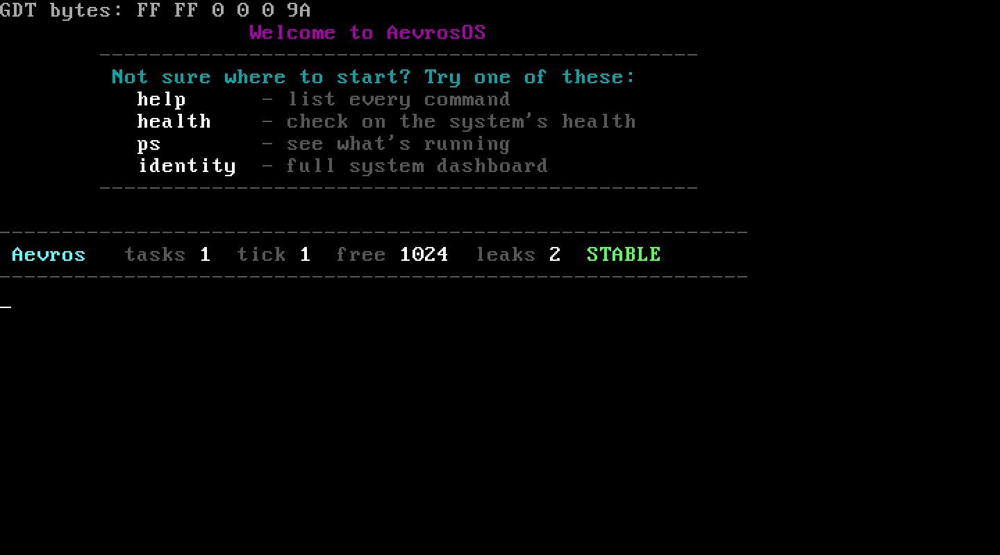
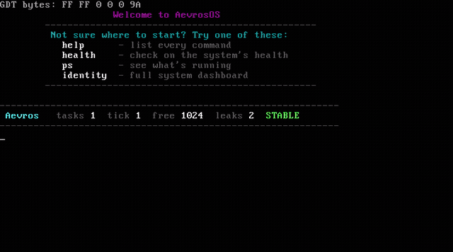
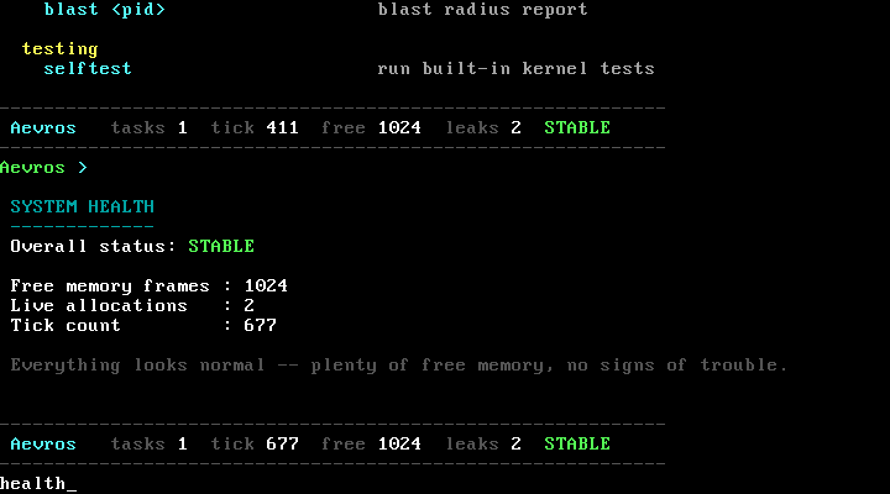
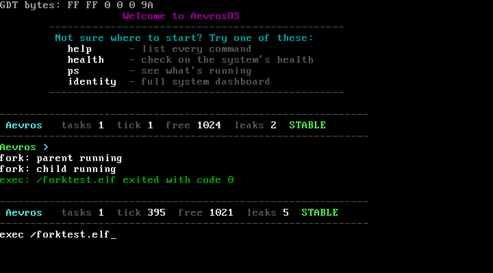

<div align="center">

# Aevros

**An operating system that explains itself.**

[](<https://en.wikipedia.org/wiki/C_(programming_language)>)
[](#)
[](#)
[](LICENSE)

[Philosophy](docs/PHILOSOPHY.md) • [Architecture](docs/ARCHITECTURE.md) • [Shell Commands](docs/COMMANDS.md) • [Building](docs/BUILDING.md) • [Contributing](CONTRIBUTING.md)

</div>

---





## What is Aevros

Aevros is a small operating system kernel, written from scratch in C and x86 assembly.

It exists to answer a question most educational kernels don't bother with: not just _what_ broke, but _why_. "Something went wrong" has never been useful information to anyone, ever.

Everything was written from scratch so every subsystem can be understood and modified without hidden dependencies.

The part that makes it different: a handful of built-in tools let the system explain its own state, in plain English, from inside the shell instead of hex dump. Kill a process and see exactly what you just ruined. Inspect an allocation and find out who's responsible for it. Trigger a page fault and get a sentence back instead of a wall of hex doing its best to ruin your afternoon.

That's the whole project in one line: a kernel that can answer "why" about itself. Full writeup in [`docs/PHILOSOPHY.md`](docs/PHILOSOPHY.md).

## In action

This is `health`, one of the introspection tools, reporting on the system live:



And this is `fork()` and `exec()` actually running, a process forking into a parent and a child, then loading and running an ELF binary:



No debugger. No print statements added for the screenshot. The kernel just answers the question, this is what that looks like.

## Core ideas

- **Nothing borrowed.** The physical memory manager, buddy and slab allocators, paging code, scheduler, VFS, ELF loader, and shell are all original, built to actually understand each piece rather than copy a known-good design.
- **State is logged, not just changed.** Every task keeps a history of what happened to it. Every allocation is tied back to a file, a line, and an owning process. Nothing changes silently.
- **Failures explain themselves.** A page fault doesn't just print a faulting address, it tells you in a sentence what kind of access failed and what that usually means. See [`decode_fault`](kernel/Paging/Aevros_Panic/aevros_panic.c) and the panic screen built on top of it.
- **Built to be read, not just run.** A subsystem and the tool that explains it live next to each other in the tree. `kernel/Process/Blast` sits right beside `kernel/Process/task.c`.

## Try it right now

```bash
git clone https://github.com/Mobeen0119/Aevros.git
cd Aevros
./build.sh
qemu-system-i386 -cdrom aevrosos.iso
```

Few moments, and you're at a shell that can explain itself. Details: [`docs/BUILDING.md`](docs/BUILDING.md).

## What's actually working

| Area                                                                                           | Status                                                         |
| ---------------------------------------------------------------------------------------------- | -------------------------------------------------------------- |
| Boot, GDT/IDT/PIC, interrupts                                                                  | Working                                                        |
| Physical memory, paging, buddy + slab allocators                                               | Working                                                        |
| Allocation tracker (file, line, owner, per alloc)                                              | Working                                                        |
| Scheduler, fork/exec, ELF loader                                                               | Working (round-robin, timer-driven, no priorities)             |
| Syscalls (`int 0x80`), VFS, RAMFS                                                              | Working                                                        |
| `whyalive`, `blast`, `quarantine`, `memfreeze`, checkpoint/restore                             | Working                                                        |
| Network diagnostics: NetWatch (event log), NetTrace (request/reply pairing), NetView (overlay) | Builds and links, host-tested                                  |
| Provenance (cause-and-effect log: NIC driver to packet to reply), `provenance` shell command   | Builds and links, host-tested, not yet observed in a live boot |
| DevFS, full ring 3 isolation                                                                   | Experimental / partial                                         |

Every "Working" row has a real self-test in `kernel/selftest.c`, run `selftest` yourself. Full table: [`README` implementation matrix in the repo](docs/ARCHITECTURE.md).

## Networking diagnostics and provenance

- **NetWatch** logs the packets the NIC sees (RX and TX, IPv4/IPv6/ARP, TCP/UDP/ICMP).
- **NetTrace** pairs a request with its reply and marks it answered, pending or timed out.
- **NetView** shows both in a full-screen overlay.
- **Provenance** (`Provenance/`) logs cause-and-effect edges, like `DRIVER:1 --CREATED--> NETWORK:5`, so you can trace where a packet came from. The `provenance` shell command lists them.

## Running the tests

```bash
./tests/run_all.sh
```

Runs the networking and provenance tests, then a demo of the `provenance` command. This tests the logic, not a booted kernel with a real NIC.

## Where this is going

Today, Aevros is a hobby kernel.

**Long-term vision:** it's the operating system you reach for when you're tired of guessing why something broke.

Because debugging should feel less like archaeology, and more like asking a question.

**In the near term, concretely:**

- Real memory protection between user tasks, full ring 3, not partial
- Task priorities on top of the timer-driven round-robin (preemption itself already works: the timer takes the CPU from a task every 0.6 s)
- Proper Networking And GUI for better experience.
- Every existing subsystem passing the two-question test from [`PHILOSOPHY.md`](docs/PHILOSOPHY.md): can it say why it's still alive, and can it say what breaks if it's removed

## Status and stability

Aevros is under active development. Subsystems get rewritten as understanding improves, they don't get left alone just because they work. If you're evaluating this for anything beyond learning and experimentation, don't, not yet. That's not false modesty, it's just accurate: no full ring 3 isolation, no preemptive scheduler.

## License

MIT, see [`LICENSE`](LICENSE). Use it, modify it, ship it, including commercially, just keep the license and copyright notice attached.

## Contributing

Contributions welcome. Read [`CONTRIBUTING.md`](CONTRIBUTING.md) first, then [`docs/ARCHITECTURE.md`](docs/ARCHITECTURE.md) to get oriented before touching a subsystem. Issues tagged `good-first-issue` are a decent place to start.
